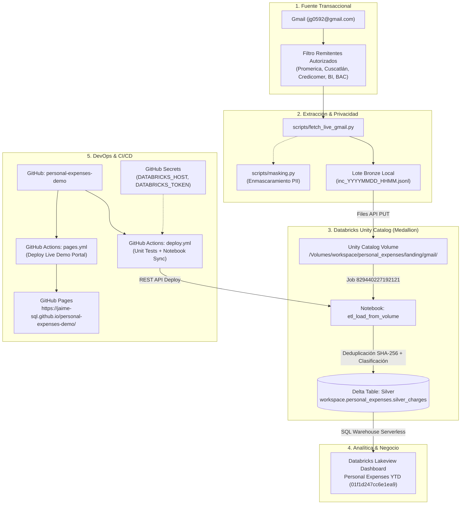

# 📋 Live Demo Playbook: Data Engineering End-to-End

Guion operativo y paso a paso para la presentación en vivo del pipeline de datos: **Gmail &rarr; Databricks Unity Catalog &rarr; Lakeview &rarr; CI/CD**.

---

## 🏛️ Diagrama de Arquitectura Completo



---

## 🎬 Guion Paso a Paso para la Demo en Vivo

### Acto 1: Introducción y Presentación de la Arquitectura (1 minuto)
* **Objetivo:** Captar la atención mostrando el problema de negocio y la solución web en vivo.
* **Acción:** Abrir en el navegador: [https://jaime-sql.github.io/personal-expenses-demo/](https://jaime-sql.github.io/personal-expenses-demo/).
* **Puntos clave a explicar:**
  1. *El reto:* Las personas reciben alertas de compras y transferencias dispersas en correos electrónicos de múltiples entidades financieras.
  2. *La solución:* Un pipeline moderno que extrae en tiempo real, aplica enmascaramiento de datos personales (PII) y orquesta una arquitectura Medallion en Databricks con CI/CD automático.

---

### Acto 2: Extracción en Vivo desde Gmail con Protección PII (1.5 minutos)
* **Objetivo:** Mostrar la ingesta directa desde el buzón de correo sin exponer información sensible de tarjetas ni nombres.
* **Comando a ejecutar en terminal:**
  ```powershell
  cd "C:\Users\jaime\.gemini\antigravity\scratch\personal-expenses-demo"
  python scripts/fetch_live_gmail.py 10 landing/messages.json
  ```
* **Qué verá la audiencia:**
  * Búsqueda por remitentes bancarios permitidos.
  * Descarga y normalización de fechas a estándar internacional ISO 8601 UTC.
* **Explicación:**
  > *"Noten cómo el pipeline no extrae correos al azar: solo interactúa con los remitentes bancarios autorizados y normaliza las marcas de tiempo para el motor distribuido de Spark."*

---

### Acto 3: Ingesta Bronze y Enmascaramiento en Vivo (1.5 minutos)
* **Objetivo:** Generar el lote Bronze y mostrar el preview de transacciones enmascaradas.
* **Comando a ejecutar:**
  ```powershell
  python scripts/daily_gmail_ingest.py landing/messages.json --masked
  ```
* **Qué verá la audiencia:**
  * Salida tabular en consola donde las tarjetas aparecen como `**43`, `**81`, `**46`.
  * Nombres propios y cuentas bancarias anonimizados automáticamente.
  * Mensaje confirmando la carga hacia el volumen de Unity Catalog: `uploaded /Volumes/workspace/personal_expenses/landing/gmail/inc_...jsonl`.
* **Explicación:**
  > *"Aquí vemos la capa de enmascaramiento en acción: el equipo de operaciones o la audiencia de la demo puede auditar el pipeline en vivo sin que se filtren los dígitos reales de las tarjetas de crédito ni los números de cuenta."*

---

### Acto 4: Procesamiento Distribuido en Databricks (2 minutos)
* **Objetivo:** Disparar y auditar la ejecución del Job en Databricks.
* **Comando a ejecutar:**
  ```powershell
  $token = (Get-Content "$HOME\.databrickscfg" | Select-String "token = (.*)").Matches.Groups[1].Value.Trim()
  $headers = @{ Authorization = "Bearer $token"; "Content-Type" = "application/json" }
  Invoke-RestMethod -Uri "https://dbc-6b5953ee-73b5.cloud.databricks.com/api/2.1/jobs/run-now" -Headers $headers -Method Post -Body (@{ job_id = 829440227192121 } | ConvertTo-Json)
  ```
* **Puntos a destacar:**
  1. **Idempotencia:** Si procesamos una alerta que ya existe en el histórico, el hash SHA-256 (`charge_id`) evita duplicar el gasto.
  2. **Categorización:** Spark asigna dinámicamente si el gasto fue en *combustible, supermercado, restaurante, compras o servicios*.
  3. **Integridad:** Se ejecutan aserciones matemáticas automáticas (`assert v['n_all'] == v['n_ids']`).

---

### Acto 5: Visualización de Negocio en Databricks Lakeview (1 minuto)
* **Objetivo:** Mostrar el valor de negocio final para el usuario.
* **Acción:** Abrir en el navegador el dashboard **Personal Expenses YTD** en el workspace de Databricks.
* **Qué mostrar:**
  * Total acumulado de gastos del año vs. consumo neto.
  * Distribución de compras por categoría y comercios frecuentes.
  * Enlace auditable que permite saltar desde el cargo analítico hacia el correo original en Gmail.

---

### Acto 6: DevOps & CI/CD con GitHub Actions (1 minuto)
* **Objetivo:** Probar la madurez de ingeniería de software aplicada a datos.
* **Acción:** Mostrar en GitHub la pestaña de **Actions**: [https://github.com/jaime-sql/personal-expenses-demo/actions](https://github.com/jaime-sql/personal-expenses-demo/actions).
* **Puntos clave:**
  1. Cada commit corre pruebas unitarias automáticas para verificar que ningún cambio rompa los parsers de bancos.
  2. Despliegue continuo hacia el workspace de Databricks usando credenciales seguras inyectadas por **GitHub Secrets**.
  3. Despliegue estático del portal en **GitHub Pages**.
