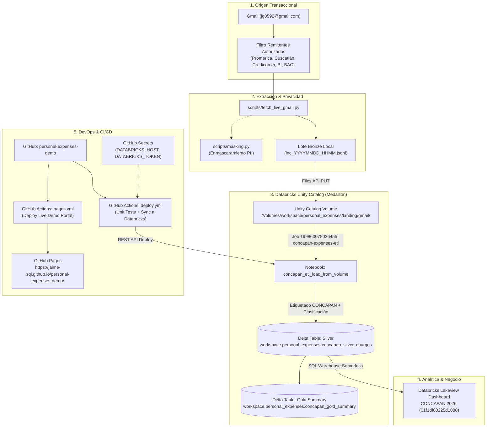

# 📋 Live Demo Playbook: CONCAPAN Data Engineering Pipeline

Guion operativo y paso a paso para la presentación en vivo del pipeline de datos: **Gmail &rarr; Databricks Unity Catalog &rarr; concapan-expenses-etl &rarr; Lakeview &rarr; CI/CD**.

---

## 🏛️ Diagrama de Arquitectura de la Demo



---

## 🎬 Guion Paso a Paso para la Demo en Vivo

### Acto 1: Introducción y Presentación de la Arquitectura (1 minuto)
* **Objetivo:** Captar la atención mostrando el problema de negocio y el portal web en vivo.
* **Acción:** Abrir en el navegador: [https://jaime-sql.github.io/personal-expenses-demo/](https://jaime-sql.github.io/personal-expenses-demo/).
* **Puntos clave a explicar:**
  1. *El reto:* Centralizar y etiquetar en tiempo real los gastos de viaje, logística y consumos para la convención CONCAPAN 2026.
  2. *La solución:* Un pipeline en Databricks Free Edition que extrae alertas, protege la privacidad con enmascaramiento PII y orquesta un Job dedicado (`concapan-expenses-etl`) con un dashboard Lakeview ejecutivo.

---

### Acto 2: Extracción en Vivo desde Gmail con Protección PII (1.5 minutos)
* **Objetivo:** Mostrar la ingesta directa desde el buzón de correo sin exponer información sensible.
* **Comando a ejecutar en terminal:**
  ```powershell
  cd "C:\Users\jaime\.gemini\antigravity\scratch\personal-expenses-demo"
  python scripts/fetch_live_gmail.py 10 landing/messages.json
  ```
* **Qué verá la audiencia:**
  * Búsqueda por remitentes bancarios permitidos.
  * Descarga y normalización de fechas a estándar internacional ISO 8601 UTC.

---

### Acto 3: Ingesta Bronze y Enmascaramiento en Vivo (1.5 minutos)
* **Objetivo:** Generar el lote Bronze y mostrar el preview de transacciones enmascaradas.
* **Comando a ejecutar:**
  ```powershell
  python scripts/daily_gmail_ingest.py landing/messages.json --masked
  ```
* **Qué verá la audiencia:**
  * Salida tabular en consola donde las tarjetas aparecen como `**43`, `**81`, `**46`.
  * Nombres propios y cuentas bancarias anonimizados automáticamente.
  * Mensaje confirmando la carga hacia el volumen de Unity Catalog: `uploaded /Volumes/workspace/personal_expenses/landing/gmail/inc_...jsonl`.

---

### Acto 4: Orquestación del Job `concapan-expenses-etl` en Databricks (2 minutos)
* **Objetivo:** Disparar y auditar la ejecución del Job CONCAPAN en Databricks.
* **Comando a ejecutar:**
  ```powershell
  $token = (Get-Content "$HOME\.databrickscfg" | Select-String "token = (.*)").Matches.Groups[1].Value.Trim()
  $headers = @{ Authorization = "Bearer $token"; "Content-Type" = "application/json" }
  Invoke-RestMethod -Uri "https://dbc-6b5953ee-73b5.cloud.databricks.com/api/2.1/jobs/run-now" -Headers $headers -Method Post -Body (@{ job_id = 199860078036455 } | ConvertTo-Json)
  ```
* **Puntos a destacar:**
  1. **Aislamiento:** Este Job (`199860078036455`) es exclusivo de la demo y no toca `personal-expenses-etl`.
  2. **Etiquetado CONCAPAN:** Clasifica gastos por eje operativo (*IEEE / CONCAPAN Official, Travel & Lodging, Transportation / Fuel, Dining & Catering*).
  3. **Capas Silver y Gold:** Genera `concapan_silver_charges` y `concapan_gold_summary`.

---

### Acto 5: Visualización en Databricks Lakeview: Dashboard CONCAPAN (1 minuto)
* **Objetivo:** Mostrar el nuevo diseño del dashboard ejecutivo.
* **Acción:** Abrir en el navegador:
  👉 [https://dbc-6b5953ee-73b5.cloud.databricks.com/dashboardsv3/01f1df80225d108082ecb2b8ace88bd7/published](https://dbc-6b5953ee-73b5.cloud.databricks.com/dashboardsv3/01f1df80225d108082ecb2b8ace88bd7/published)
* **Qué destacar del nuevo diseño:**
  * **4 KPIs Superiores:** Total Desembolsos, Consumo Operativo, Logística/Viajes y Total Transacciones.
  * **Distribución por Eje Operativo:** Gráfico de barras horizontal separando logística, viáticos y catering.
  * **Consumo por Categoría:** Gráfico de barras con ranking de categorías.
  * **Tendencia Temporal:** Evolución mensual de desembolsos.
  * **Auditoría Detallada:** Tabla con comercio, fecha, banco, tarjeta enmascarada y monto.

---

### Acto 6: DevOps & CI/CD con GitHub Actions (1 minuto)
* **Objetivo:** Demostrar la automatización completa.
* **Acción:** Mostrar en GitHub la pestaña de **Actions**: [https://github.com/jaime-sql/personal-expenses-demo/actions](https://github.com/jaime-sql/personal-expenses-demo/actions).
* **Puntos clave:**
  1. Sincronización automática de notebooks hacia Databricks Workspace.
  2. Despliegue y publicación del dashboard Lakeview por código (`deploy_concapan_dashboard.py`).
  3. Portal de la demo publicado en GitHub Pages.
