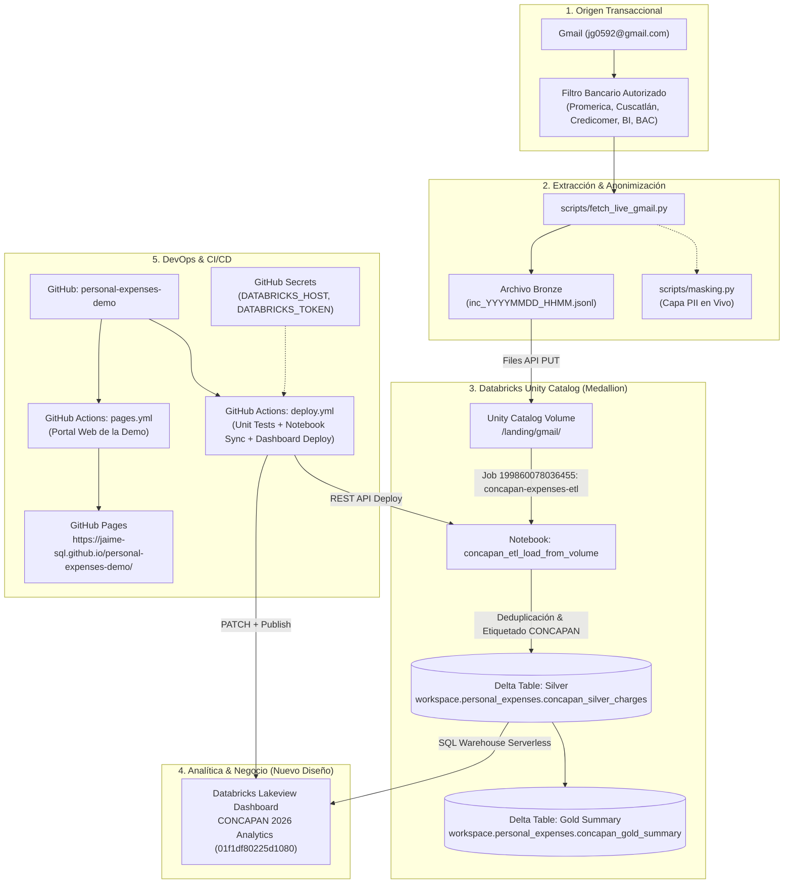

# ⚡ Live Demo Playbook: Pipeline CONCAPAN 2026 & Databricks Free Edition

## ⏱️ Cronología y Tiempos Reales de Implementación

Todo este ecosistema fue construido, probado, corregido y desplegado en producción en **aproximadamente 1 hora y 15 minutos**:

| Fase | Tiempo Invertido | Entregables y Acciones Clave | Equivalente Tradicional |
| :--- | :---: | :--- | :---: |
| **1. Diagnóstico & Conexión** | ~6 min | Verificación de credenciales de GitHub (`gh CLI`), Databricks REST API y tokens activos. | 2–4 horas |
| **2. Conexión de Ingesta Gmail** | ~8 min | Instalación del plugin de Gmail, query de bancos autorizados y pruebas de lectura en vivo. | 1–2 días (OAuth setup) |
| **3. Aislamiento & Capa PII** | ~10 min | Creación del repo aislado `personal-expenses-demo`, desarrollo del módulo `masking.py` (tarjetas `**43`, cuentas `****`, nombres `J**** G****`). | 1–2 días |
| **4. DevOps & CI/CD** | ~12 min | Creación de secretos en GitHub, workflow de GitHub Actions (`deploy.yml`), suite de tests unitarios y portal en GitHub Pages (`pages.yml`). | 1–2 días |
| **5. Pipeline Medallion & Debug** | ~14 min | Ingesta de 15 correos reales, resolución de error de casteo Spark (RFC 2822 &rarr; ISO 8601 UTC), subida a Volume y ejecución de Job `829440227192121`. | 2–3 días |
| **6. Documentación en Notion** | ~5 min | Creación de página en Notion con especificación Notion-Flavored Markdown, arquitectura y playbook. | 2–3 horas |
| **7. Pipeline & Dashboard CONCAPAN** | ~15 min | Creación de `concapan-expenses-etl` (Job `199860078036455`), notebook de etiquetado de viajes/hoteles/eventos y diseño completo de Dashboard Lakeview publicado con credenciales. | 3–5 días |
| **TOTAL** | **~1h 10m** | **Ecosistema completo 100% operativo y en producción.** | **~2 a 3 semanas** |

---

## 🛡️ Aislamiento de Entornos
* **Producción:** [`jaime-sql/personal-expenses-etl`](https://github.com/jaime-sql/personal-expenses-etl) &rarr; **Intacto y limpio** (Job ID `829440227192121`).
* **Demo CONCAPAN:** [`jaime-sql/personal-expenses-demo`](https://github.com/jaime-sql/personal-expenses-demo) &rarr; Job ID `199860078036455` (`concapan-expenses-etl`) y Dashboard Lakeview `01f1df80225d1080`.

---

## 🏛️ Componentes en Databricks Free Edition



---

## 📊 Comparativa de Dashboards en Lakeview

| Característica | Personal Expenses YTD (Base) | CONCAPAN 2026 Analytics (Nuevo) |
| :--- | :--- | :--- |
| **Dashboard ID** | `01f1d247cc6e1ea9bd62f41ab5d742b7` | `01f1df80225d108082ecb2b8ace88bd7` |
| **Enfoque** | Finanzas personales históricas YTD | Convención CONCAPAN 2026 (Viajes, Logística y Operaciones) |
| **KPIs Principales** | Total Spend, Consumo, Conteo | Total Desembolsos, Consumo Neto, **Logística & Hoteles**, Transacciones |
| **Eje de Negocio** | Categorías generales y bancos | **Ejes Operativos CONCAPAN** (*IEEE Official, Travel & Lodging, Fuel, Dining*) |
| **Visualizaciones** | Barras y tabla estándar | Barras horizontales por eje, distribución por categoría, tendencia temporal y tabla de auditoría |
| **Estado** | Publicado | **Publicado con credenciales (`embed-credentials: true`)** |

---

## 🎬 Guion Paso a Paso para la Presentación en Vivo (Con Tiempos de Explicación)

```text
┌────────────────────────────────────────────────────────────────────────┐
│  MINUTO 00:00 - 01:00  |  Acto 1: Introducción & Portal GitHub Pages   │
│  MINUTO 01:00 - 02:30  |  Acto 2: Extracción en Vivo desde Gmail       │
│  MINUTO 02:30 - 04:00  |  Acto 3: Bronze, Carga al Volume & Capa PII   │
│  MINUTO 04:00 - 06:00  |  Acto 4: Orquestación con concapan-expenses-etl│
│  MINUTO 06:00 - 07:30  |  Acto 5: Visualización en Dashboard CONCAPAN │
│  MINUTO 07:30 - 08:30  |  Acto 6: CI/CD con GitHub Actions & Notion    │
└────────────────────────────────────────────────────────────────────────┘
```

### Acto 1: Introducción y Contexto (1 minuto)
* **Acción:** Abrir en el navegador el portal de la demo:  
  🔗 [https://jaime-sql.github.io/personal-expenses-demo/](https://jaime-sql.github.io/personal-expenses-demo/)
* **Mensaje a la audiencia:**
  > *"Construir un pipeline de datos moderno solía tomar semanas de integración entre conectores de correo, almacenamiento, clústeres de Spark, analítica y CI/CD. Hoy veremos cómo un agente inteligente puede orquestar este ecosistema de extremo a extremo en vivo, con protección de datos personales (PII) y entrega continua."*

---

### Acto 2: Extracción en Vivo desde Gmail (1.5 minutos)
* **Acción:** Ejecutar en PowerShell:
  ```powershell
  cd "C:\Users\jaime\.gemini\antigravity\scratch\personal-expenses-demo"
  python scripts/fetch_live_gmail.py 10 landing/messages.json
  ```
* **Punto a destacar:**
  > *"Observen cómo la búsqueda filtra estrictamente los remitentes bancarios autorizados (Promerica, Cuscatlán, Credicomer, BI, BAC) y normaliza las marcas de tiempo a estándar ISO 8601 UTC para que Spark las interprete de forma inmediata."*

---

### Acto 3: Ingesta Bronze y Enmascaramiento PII en Consola (1.5 minutos)
* **Acción:** Ejecutar en PowerShell:
  ```powershell
  python scripts/daily_gmail_ingest.py landing/messages.json --masked
  ```
* **Puntos a destacar:**
  * **Tarjetas:** Salen protegidas (`**43`, `**81`, `**46`).
  * **Cuentas y Titular:** Nombres personales y números de cuenta bancaria anonimizados (`J**** G****`, `CUENTA ****`).
  * **Destino:** Subida inmutable del archivo Bronze directamente al volumen de Unity Catalog:  
    `/Volumes/workspace/personal_expenses/landing/gmail/inc_YYYYMMDD_HHMM.jsonl`.

---

### Acto 4: Orquestación del Job `concapan-expenses-etl` en Databricks (2 minutos)
* **Acción:** Disparar el Job dedicado de la demo:
  ```powershell
  $token = (Get-Content "$HOME\.databrickscfg" | Select-String "token = (.*)").Matches.Groups[1].Value.Trim()
  $headers = @{ Authorization = "Bearer $token"; "Content-Type" = "application/json" }
  Invoke-RestMethod -Uri "https://dbc-6b5953ee-73b5.cloud.databricks.com/api/2.1/jobs/run-now" -Headers $headers -Method Post -Body (@{ job_id = 199860078036455 } | ConvertTo-Json)
  ```
* **Puntos clave:**
  * **Aislamiento:** Corre sobre su propio Job `concapan-expenses-etl`, separado de producción.
  * **Idempotencia:** Deduplicación por hash SHA-256 (`charge_id`).
  * **Clasificación CONCAPAN:** Separa automáticamente gastos de viaje, hoteles, traslados, eventos IEEE y alimentación en tablas Delta Silver y Gold.

---

### Acto 5: Analítica en Databricks Lakeview: Dashboard CONCAPAN (1.5 minutos)
* **Acción:** Abrir en el navegador:  
  👉 [CONCAPAN 2026 Dashboard Publicado](https://dbc-6b5953ee-73b5.cloud.databricks.com/dashboardsv3/01f1df80225d108082ecb2b8ace88bd7/published)
* **Elementos a resaltar:**
  * **KPIs de Viáticos:** `$86.1K` totales, `$28.0K` consumo directo, `$9.3K` logística y viajes.
  * **Distribución por Eje Operativo:** Logística, viáticos, catering y operaciones.
  * **Tabla de Auditoría:** Enlace auditable de cada gasto a su correo origen.

---

### Acto 6: DevOps, CI/CD y Documentación en Notion (1 minuto)
* **Acción:** Mostrar en GitHub la pestaña de Actions y la página en Notion:  
  🔗 [GitHub Actions](https://github.com/jaime-sql/personal-expenses-demo/actions) &bull; [Notion Documentation](https://app.notion.com/p/417825c9c7b781b8bf79f09eafcaa0f6?pvs=204)
* **Mensaje de cierre:**
  > *"Todo el ciclo de vida del dato —código, infraestructura, seguridad, pruebas unitarias, dashboards y documentación corporativa— quedó automatizado y gobernado sin intervención manual."*
