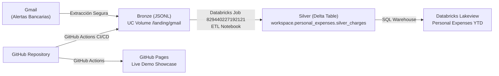

# Databricks & Gmail Data Pipeline — Live Demo

[](https://github.com/jaime-sql/personal-expenses-demo/actions/workflows/deploy.yml)
[](https://github.com/jaime-sql/personal-expenses-demo/actions/workflows/pages.yml)

Demo en vivo de ingeniería de datos de extremo a extremo:
1. **Extracción:** Alertas de transacciones bancarias desde **Gmail** (Promerica, Cuscatlán, Credicomer, BI, BAC).
2. **Ingesta Bronze:** Archivos inmutables `inc_YYYYMMDD_HHMM.jsonl` en **Unity Catalog Volumes**.
3. **Transformación Silver:** Normalización, deduplicación idempotente (`charge_id`), categorización de gastos y enmascaramiento de datos personales en **Delta Lake**.
4. **Visualización:** Tablero analítico en **Databricks Lakeview** (*Personal Expenses YTD*).
5. **CI/CD:** Automatización de pruebas y despliegue a Databricks con **GitHub Actions** y documentación publicada en **GitHub Pages**.

---

## 🏛️ Arquitectura del Pipeline



---

## 🛡️ Capa de Privacidad y Enmascaramiento PII

Para demostraciones en vivo y entornos compartidos, el pipeline incluye:
* **Enmascaramiento de tarjetas:** Solo muestra los últimos dos dígitos (`**43`, `**81`).
* **Anonimización de nombres y cuentas:** Nombres personales y números de cuenta bancaria son redactados automáticamente.
* **Cero secretos en código:** Credenciales gestionadas mediante **GitHub Secrets** (`DATABRICKS_HOST`, `DATABRICKS_TOKEN`).
* **Protección Git:** Datos transaccionales sin procesar (`landing/`, `*.jsonl`) quedan excluidos de control de versiones mediante `.gitignore`.

---

## 🚀 Despliegue y Ejecución

### 1. Extracción desde Gmail
```bash
python scripts/fetch_live_gmail.py 25 landing/messages.json
```

### 2. Ingesta a Unity Catalog (con enmascaramiento para demo)
```bash
python scripts/daily_gmail_ingest.py landing/messages.json --masked
```

### 3. CI/CD con GitHub Actions
Cualquier cambio en `scripts/` o `config/` desplegará automáticamente el notebook hacia el Workspace de Databricks:
* **Workflow:** `.github/workflows/deploy.yml`
* **Página de la Demo:** `.github/workflows/pages.yml`
